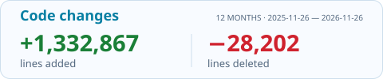

<picture>
  <source media="(prefers-reduced-motion: reduce)" srcset="assets/header-motion-poster.png?v=ad569fe205b2">
  
</picture>

I’m Daniyar, a software engineer with 5+ years of experience building Go services and security tools. I’ve built systems that estimate train arrival times from GPS readings and process telemetry from LoRaWAN devices over MQTT.

[LinkedIn](https://linkedin.com/in/danonika) · [Google Scholar](https://scholar.google.com/citations?user=Dwtw4AUAAAAJ)

## Selected work

- **Hackathon Agent Kit** is my current project. It gives coding agents tools to inspect a repository, plan changes, and run tests. The runtime is written in Go, exposes tools through MCP, and stores session history in SQLite. The source is private.
- **Somnium** is a recruitment backend for job listings and applications. It exposes HTTP and gRPC APIs backed by PostgreSQL. [Source code](https://github.com/Danonika/somnium-hh-go)
- **SAGE** is a GPU attestation research project. I contributed a C++ change that replaced a fixed seed in its checksum launcher with hardware-generated randomness. [Merged pull request](https://github.com/spcl/sage/pull/1)

## Research

I co-authored *A Survey of Cross-Layer Security for Resource-Constrained IoT Devices*, published in *Applied Sciences* in 2025. [Read the paper](https://doi.org/10.3390/app15179691)

## Education

**Eurasian National University** · Astana, Kazakhstan 
Bachelor’s degree in Information Security Technologies · September 2018–July 2022 · GPA 3.5/4.0

## Competitive programming awards

- **ICPC Northern Eurasian Finals** (2020–2023) — honorable mention and third-degree award.
- **Kazakh Republic Olympiad in Informatics** (2015–2018) — one gold, two silver, and one bronze medal.
- **Eurasian Olympiad in Informatics** (2015–2017) — one silver and two bronze medals.
- **Zhautykov International Olympiad in Informatics** (2017) — bronze medal.

## Technical skills

Go, Python, SQL, PostgreSQL, Redis, Kafka, Docker, and Kubernetes.

Full toolbox

<strong>Programming languages</strong> 

<strong>Cloud &amp; infrastructure</strong> 

<strong>Databases, caching &amp; messaging</strong> 

<strong>Frameworks &amp; tools</strong> 

<strong>Observability</strong> 

<strong>Methodologies &amp; engineering</strong> 

<strong>Testing</strong> 

<strong>AI engineering</strong> 

## GitHub activity

<!-- STATS:START -->
<picture>
  <source media="(prefers-color-scheme: dark)" srcset="assets/stats/activity-dark.svg">
  
</picture>
<picture>
  <source media="(prefers-color-scheme: dark)" srcset="assets/stats/code-changes-compact-dark.svg">
  
</picture>

Public + accessible private activity. Code changes cover authored, non-merge commits on default branches over the past 12 months. Updated daily. [How these stats are counted](assets/stats/README.md).
<!-- STATS:END -->
